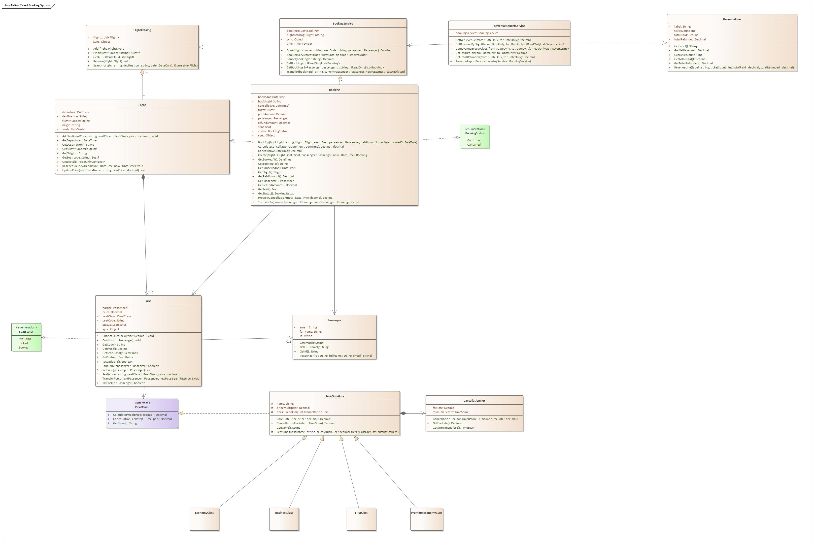

# Airline Ticket Booking System

OOP Final Project — hệ thống đặt vé máy bay: tìm chuyến bay, chọn/khóa ghế theo hạng, hủy vé và hoàn tiền theo hạng ghế và thời gian còn lại trước giờ bay, hoặc chuyển vé sang hành khách khác.
Ứng dụng hiện dùng các chuyến bay mẫu; vé, trạng thái ghế và danh tính hành khách được lưu trong bộ nhớ trong thời gian ứng dụng chạy.

## Cấu trúc solution

| Project | Loại | Nội dung |
|---|---|---|
| `AirlineBooking.Core` | Class Library (.NET 8) | Toàn bộ logic nghiệp vụ, không phụ thuộc giao diện |
| `AirlineBooking.WinForms` | Windows Forms App (.NET 8) | Giao diện, chỉ gọi vào `BookingService` / `FlightCatalog` |
| `AirlineBooking.Core.Tests` | xUnit (.NET 8) | Kiểm thử tìm chuyến, đặt/hủy, giữ ghế và hoàn tiền |

```
AirlineBooking.Core/
├── Chuyến bay, ghế, vé:  Flight, Seat, Passenger, Booking, SeatStatus, BookingStatus
├── Hạng ghế:             ISeatClass, SeatClassBase, CancellationTier,
│                         EconomyClass, BusinessClass, PremiumEconomyClass, FirstClass
├── Dịch vụ:              FlightCatalog, BookingService, RevenueReportService, RevenueLine
└── Exception:            SeatUnavailableException, InvalidBookingStateException, FlightNotFoundException
AirlineBooking.WinForms/
├── Chung:                FrmLogin, UiKit
├── Người dùng:           FrmUserMain, FrmSearchFlight, FrmSeatMap, FrmBookingConfirm, FrmMyBookings, DemoData
└── Admin/                FrmAdminMain, FrmFlightManager, FrmFlightEdit, FrmBookingManager, FrmRevenueReport,
                          AdminTheme, AdminDemoData, Controls/ (CardPanel, MenuCard, BarChart, SeatLabel)
docs/                     Class diagram (ảnh + file Enterprise Architect), kế hoạch thực hiện, AI Usage Log
AirlineBooking.Core.Tests/ Kiểm thử tự động luồng đặt vé
```

## Class diagram



Bản Mermaid (GitHub tự vẽ, khớp với code): [docs/class-diagram.md](docs/class-diagram.md)

## Yêu cầu

- Windows 10/11
- .NET 8 SDK (hoặc mới hơn)
- Visual Studio 2022 (tùy chọn)

## Build & Run

```bash
dotnet build AirlineBooking.sln
```

```bash
dotnet run --project AirlineBooking.WinForms
```

Chạy kiểm thử tự động:

```bash
dotnet test AirlineBooking.Core.Tests\AirlineBooking.Core.Tests.csproj
```

Hoặc mở `AirlineBooking.sln` bằng Visual Studio, chọn `AirlineBooking.WinForms` làm Startup Project và nhấn F5.

## Thành viên

| Thành viên | Phụ trách |
|---|---|
| Trần Quốc Huy | Class diagram, kế hoạch, giao diện & chức năng Admin (tạo vé, quản lý vé, báo cáo doanh thu) |
| Ngô Thành Đạt | Hiện thực code từ class diagram, giao diện & chức năng Người dùng (tìm chuyến, chọn ghế, đặt / hủy vé) |

Kế hoạch chi tiết: [docs/PLAN.md](docs/PLAN.md)

Nhật ký sử dụng AI: [docs/AI_USAGE_LOG.md](docs/AI_USAGE_LOG.md)
