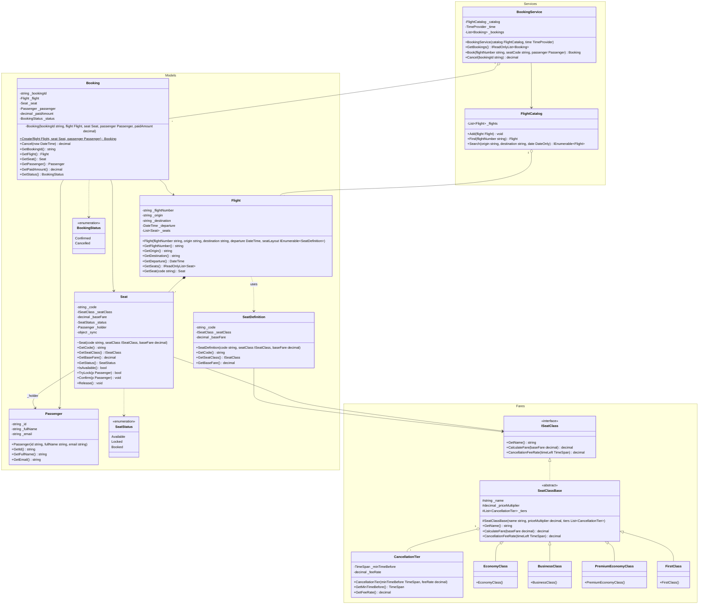

# Class Diagram

Bản vẽ chính thức (Enterprise Architect): [class-diagram.jpg](class-diagram.jpg) — file gốc: [AirlineBooking.eap](AirlineBooking.eap)

Bản dưới đây viết bằng Mermaid, GitHub tự vẽ thành sơ đồ và luôn khớp với code trong `AirlineBooking.Core`.

## Ký hiệu

| Mermaid | UML | Ý nghĩa trong bài |
|---|---|---|
| `*--` | Composition | `Flight` sở hữu các `Seat` |
| `o--` | Aggregation | `FlightCatalog` quản lý `Flight`, `BookingService` quản lý `Booking`, `SeatClassBase` chứa `CancellationTier` |
| `-->` | Association | `Booking` tham chiếu `Flight` / `Seat` / `Passenger` |
| `..|>` / `<|..` | Realization | `SeatClassBase` cài đặt `ISeatClass` |
| `<|--` | Generalization | 4 hạng ghế kế thừa `SeatClassBase` |
| `..>` | Dependency | dùng enum / `SeatDefinition` |
| `-` `+` `#` `~` | private / public / protected / internal | |
| `$` | static | `Booking.Create` |
