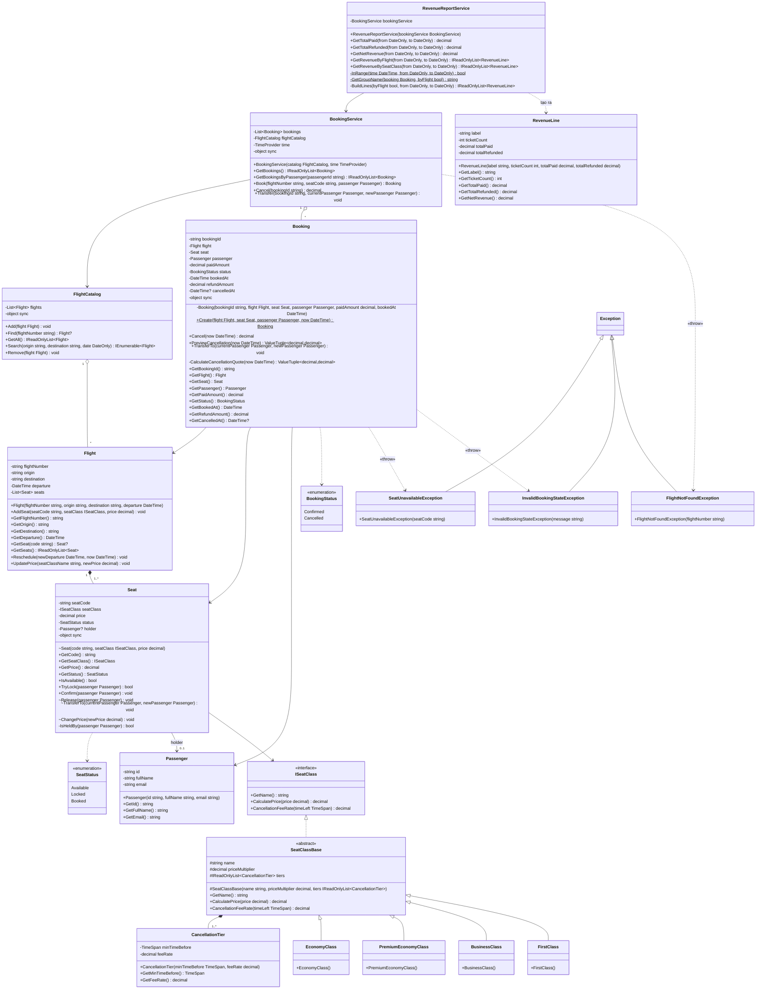

# Class Diagram

Bản vẽ chính thức (Enterprise Architect): [class-diagram.jpg](class-diagram.jpg) — file gốc: [AirlineBooking.eap](AirlineBooking.eap)

Bản dưới đây viết bằng Mermaid (GitHub tự vẽ thành sơ đồ), khớp với code project `AirlineBooking.Core` sau tuần 3.

## Thay đổi so với bản tuần 1 – 2

| Class | Thay đổi ở tuần 3 |
|---|---|
| `Flight` | `Reschedule` nhận thêm `now`; `GetSeat` trả về `Seat?` |
| `FlightCatalog` | Thêm `Remove(flight)` (chỉ xóa khi chưa có ghế nào được đặt); khóa `sync` cho mọi thao tác |
| `Seat` | `Release`, `ChangePrice` là internal; `Release` và `TransferTo` nhận hành khách để kiểm tra đúng người giữ ghế |
| `Booking` | Thêm `PreviewCancellation`, `TransferTo`; `GetCancelledAt()` trả về `DateTime?`; khóa `sync` |
| `BookingService` | Thêm `Transfer` (chuyển vé cho hành khách khác) |
| Hạng ghế | Dùng đủ 4 hạng: First, Business, Premium Economy, Economy |
| Exception | Đưa 3 exception và quan hệ «throw» vào sơ đồ |

## Ký hiệu

| Mermaid | UML | Ý nghĩa trong bài |
|---|---|---|
| `*--` | Composition | `Flight` sở hữu các `Seat`; `SeatClassBase` sở hữu bảng `CancellationTier` |
| `o--` | Aggregation | `FlightCatalog` quản lý `Flight`, `BookingService` quản lý `Booking` |
| `-->` | Association | `Booking` tham chiếu `Flight` / `Seat` / `Passenger`; `Seat` giữ `Passenger` đang đặt |
| `<\|..` | Realization | `SeatClassBase` cài đặt `ISeatClass` |
| `<\|--` | Generalization | 4 hạng ghế kế thừa `SeatClassBase`; 3 exception kế thừa `Exception` |
| `..>` | Dependency | dùng enum; `RevenueReportService` tạo `RevenueLine`; ném exception |
| `-` `+` `#` `~` | private / public / protected / internal | |
| `$` | static | `Booking.Create`, các hàm phụ trong `RevenueReportService` |
