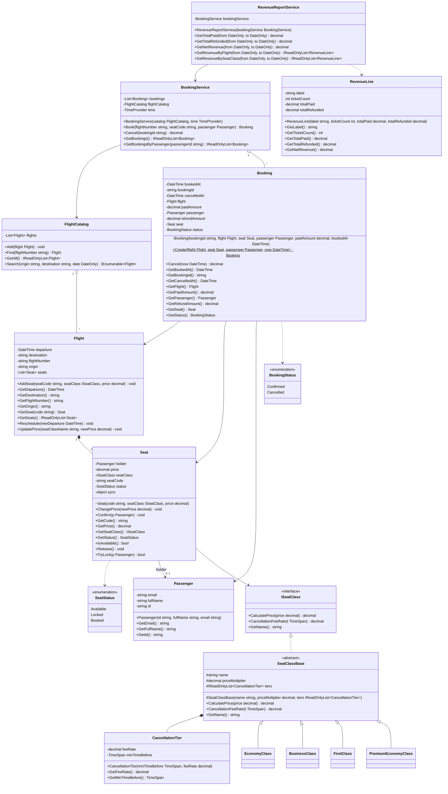

# Class Diagram

Bản vẽ chính thức (Enterprise Architect): [class-diagram.jpg](class-diagram.jpg) — file gốc: [AirlineBooking.eap](AirlineBooking.eap)

Bản dưới đây viết bằng Mermaid (GitHub tự vẽ thành sơ đồ), cùng nội dung với bản Enterprise Architect.

## Ký hiệu

| Mermaid | UML | Ý nghĩa trong bài |
|---|---|---|
| `*--` | Composition | `Flight` sở hữu các `Seat`; `SeatClassBase` sở hữu bảng `CancellationTier` |
| `o--` | Aggregation | `FlightCatalog` quản lý `Flight`, `BookingService` quản lý `Booking` |
| `-->` | Association | `Booking` tham chiếu `Flight` / `Seat` / `Passenger`; `Seat` giữ `Passenger` đang đặt |
| `<\|..` | Realization | `SeatClassBase` cài đặt `ISeatClass` |
| `<\|--` | Generalization | 4 hạng ghế kế thừa `SeatClassBase` |
| `..>` | Dependency | dùng enum; `RevenueReportService` tạo `RevenueLine` |
| `-` `+` `#` `~` | private / public / protected / internal | |
| `$` | static | `Booking.Create` |
